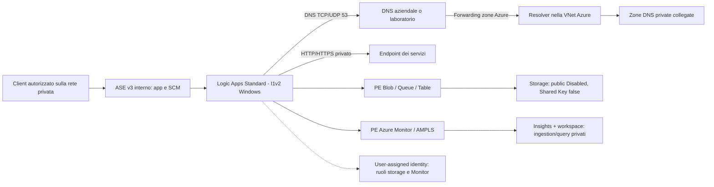

# Definire l'architettura e il piano di rete

[Indice](../README.md) | [Creazione](runbook.md) | [DNS](customer-dns.md)

Completare questo capitolo con i responsabili rete, sicurezza e applicazione
prima di creare le risorse. Registrare le scelte nel foglio parametri del
[capitolo di creazione](runbook.md#0-compilare-il-foglio-parametri-e-approvare-la-spesa).

## 1. Definire i controlli e l'ambiente

1. Elencare i servizi privati da controllare, i relativi endpoint e i
   responsabili. Per il laboratorio prevedere due endpoint HTTP.
2. Impostare controlli ogni cinque minuti con workflow Stateful e azioni
   HTTP indipendenti.
3. Selezionare ASE v3 con VIP interno, Logic App Standard e piano Windows
   Isolated v2 I1v2. Non creare una Function App separata.
4. Prevedere una sola istanza I1v2 per il laboratorio. Prima dell'uso in
   produzione concordare capacita', numero di istanze, ridondanza DNS,
   failure domain e requisiti di ripristino con i responsabili.
5. Prevedere storage Blob/Queue/Table con Private Endpoint e user-assigned
   managed identity. Mantenere Shared Key e accesso pubblico disabilitati.
6. Non prevedere connection string storage con chiavi o una share SMB per
   il contenuto del runtime. Valutare Azure Files separatamente soltanto
   se richiesto dai dati applicativi.
7. Prevedere Application Insights, workspace Log Analytics e Workbook.
   Usare la telemetria dei workflow per gli esiti; non aspettarsi la
   creazione automatica di test Availability o dati `availabilityResults`.

## 2. Scegliere regione e percorso DNS

1. Selezionare la regione e verificare SKU, quote, capacita' e policy
   nella subscription prima di approvare il progetto.
   Collocare ASE, piano e Logic App nella stessa regione.
2. Scegliere uno dei percorsi DNS seguenti e registrare IP, owner delle
   zone e direzione del forwarding.

| Percorso | Configurazione da predisporre |
|---|---|
| DNS aziendale in Azure | Resolver raggiungibili dall'ASE e zone private visibili dalla VNet dei forwarder |
| DNS on-premises | VPN/ExpressRoute e forwarding verso un inbound endpoint Private Resolver o forwarder Azure privati |
| Laboratorio autonomo | VM Windows DNS/IIS privata, collegata alle zone private, con forwarding verso Azure DNS |

3. Per DNS on-premises non usare `168.63.129.16` come destinazione diretta.
   Configurare l'IP privato del resolver inbound o del forwarder Azure.
4. Se occorre risolvere domini on-premises da Azure DNS, prevedere anche
   outbound endpoint e forwarding ruleset. Non usare il solo inbound
   endpoint per questo percorso.
5. Rendere risolvibili target, dominio ASE, storage e Monitor attraverso
   il percorso scelto. Seguire il [capitolo DNS](customer-dns.md).

### Collocare il simulatore in un'altra regione, se necessario

Se la VM non e' allocabile nella regione ASE, approvare una regione
alternativa prima di proseguire. Per l'esempio Italy North/Sweden Central:

1. Prevedere una VNet ASE/storage in Italy North, `10.60.0.0/16`.
2. Prevedere una nuova VNet per il simulatore in Sweden Central,
   `10.61.0.0/16`, subnet `10.61.2.0/24` e IP VM `10.61.2.4`.
3. Verificare disponibilita' e quote di `Standard_D2s_v7` Windows:
   2 vCPU, 8 GiB, senza disco temporaneo locale. Prevedere un OS disk gestito
   compatibile oppure scegliere una SKU approvata.
4. Prevedere global VNet peering in entrambe le direzioni.
   Verificare stato Connected dopo la creazione.
5. Impostare `10.61.2.4` come DNS della VNet ASE solo dopo aver configurato
   e verificato il servizio DNS.
6. Collegare le zone private anche alla VNet del forwarder remoto.
7. Valutare la latenza e includere nel preventivo il traffico interregionale.
   Verificare la risoluzione dal runtime durante il collaudo.

Usare reti nuove per il laboratorio. Non modificare reti esistenti senza
un change approvato.

## 3. Compilare il piano di indirizzamento

1. Verificare sovrapposizioni con VNet, hub, VPN, ExpressRoute e reti dei client.
2. Compilare la colonna dei valori assegnati; non copiare gli esempi senza
   l'approvazione del team rete.

| Elemento | Esempio | Valore assegnato | Requisito |
|---|---|---|---|
| VNet ASE | `10.60.0.0/16` | Da compilare | Nessuna sovrapposizione |
| Subnet ASE | `10.60.0.0/24` | Da compilare | Vuota, dedicata, delegata a `Microsoft.Web/hostingEnvironments` |
| Subnet Private Endpoint | `10.60.1.0/24` | Da compilare | Separata dalla subnet ASE |
| Subnet DNS/target laboratorio | `10.60.2.0/24` | Da compilare, se usata | VM privata, esempio IP `10.60.2.4` |
| Resolver inbound | `10.60.3.0/28` | Da compilare, se usato | Subnet dedicata al Private Resolver |
| Resolver outbound | `10.60.4.0/28` | Da compilare, se usato | Subnet dedicata, con forwarding ruleset |

3. Per ASE usare la dimensione raccomandata `/24` e verificare lo spazio
   richiesto da infrastruttura, standby, upgrade e scale-out.
   Non delegare la subnet a `Microsoft.Web/serverFarms`.
4. Se si usa il simulatore remoto, sostituire subnet e IP del laboratorio
   con `10.61.2.0/24` e `10.61.2.4` in tutti i parametri e comandi.

## 4. Compilare l'elenco delle risorse

Registrare nome, resource group, regione e responsabile di ciascuna risorsa.
Per risorse condivise ottenere l'approvazione del proprietario prima dell'uso.

| Risorsa | Configurazione da selezionare |
|---|---|
| Resource group | Dedicato al laboratorio, con owner e scadenza |
| ASE v3 | VIP interno; senza host group dedicato per il laboratorio |
| App Service Plan | Windows I1v2, una istanza per il laboratorio |
| Logic App Standard | Workflow Stateful con controlli indipendenti |
| User-assigned identity | Ruoli storage e Monitor limitati alle risorse richieste |
| StorageV2 | Standard_LRS per il laboratorio; Blob/Queue/Table privati |
| DNS | Resolver aziendali oppure VM Windows dedicata |
| Target | Endpoint aziendali oppure due siti IIS per il laboratorio |
| Monitor | Workspace, Insights, AMPLS e Private Endpoint |
| Accesso amministrativo | Client con routing privato; VPN/ExpressRoute o VM amministrata tramite Bastion |

Usare il VIP interno ASE per app e SCM. Non aggiungere un Private Endpoint
per l'app in questo disegno e non selezionare External VIP per facilitare
l'accesso al designer o il publishing.

## 5. Definire le regole di rete

Compilare la matrice delle porte con sorgenti, destinazioni e responsabili.
Applicare NSG, firewall e route secondo le regole approvate.

| Sorgente | Destinazione | Traffico da consentire |
|---|---|---|
| Subnet ASE | Resolver DNS | UDP e TCP 53 |
| Subnet ASE | Target | Porta del servizio; preferire HTTPS 443 |
| Subnet ASE | PE Blob/Queue/Table | TCP 443 |
| ASE e client autorizzati | Endpoint Monitor privati | TCP 443 |
| Client amministrativo | VIP interno app/SCM | HTTPS 443 |
| `AzureLoadBalancer` | ASE | Health probe sulla porta 80 secondo i requisiti Microsoft |
| Percorso amministrativo autorizzato | VM di laboratorio | RDP; non esporre la VM direttamente su Internet |

1. Verificare il percorso di ritorno per tutti i flussi.
2. Prima di applicare NSG o route ai PE, configurare le network policies
   necessarie e verificarne l'effetto.
3. Catalogare e autorizzare separatamente le dipendenze di egress:
   Entra ID, portale, certificati/CRL, bundle runtime e servizi di piattaforma.
   Non considerare l'ASE interno automaticamente isolato da Internet.
4. Inserire NAT, firewall o gateway nel progetto e nel preventivo soltanto
   se previsti dal percorso approvato.
5. Verificare che il client amministrativo possa raggiungere privatamente
   app e SCM. Non assegnare IP pubblici alla VM o accesso pubblico allo storage.

## 6. Registrare lo schema dei collegamenti

Adattare lo schema con nomi delle risorse, subnet, IP DNS e percorso
amministrativo definiti nei passaggi precedenti.

## 7. Approvare il progetto prima della creazione

- [ ] Registrare parametri, regioni, risorse e responsabili.
- [ ] Verificare indirizzi non sovrapposti e subnet ASE dedicata.
- [ ] Definire DNS, forwarding e collegamenti privati.
- [ ] Approvare matrice delle porte, accesso amministrativo ed egress.
- [ ] Verificare SKU, quote, policy e preventivo completo.
- [ ] Concordare i [test di accettazione](validation.md).
- [ ] Ottenere l'approvazione alla creazione delle risorse a pagamento.

Completata la checklist, seguire la [procedura di creazione](runbook.md).

## Riferimenti tecnici

- [Creazione ASE](https://learn.microsoft.com/azure/app-service/environment/creation).
- [Networking e DNS ASE](https://learn.microsoft.com/azure/app-service/environment/networking).
- [Logic Apps Standard su ASE, Windows](https://learn.microsoft.com/azure/logic-apps/single-tenant-overview-compare).
- [Managed identity per host storage](https://learn.microsoft.com/azure/logic-apps/create-single-tenant-workflows-azure-portal#set-up-managed-identity-access-to-your-storage-account).
